# AirBreda

Does traffic at the A27 interchange near Breda drive up NO₂ nearby? AirBreda collects two live Dutch open-data streams, stores them, and shows the measured NO₂ next to a prediction from a regression model trained on its own collected data:
- hourly NO₂ from RIVM Luchtmeetnet station NL10240 (Breda-Tilburgseweg);
- per-minute traffic from four NDW sites on the A27 at hectometer 63.

Built for the System Design & Cloud Platforms elective (ADSAI, BUas) on **AWS, eu-north-1 (Stockholm)**.

| | |
|---|---|
| **Live dashboard** | **http://16.192.119.40:8000** · JSON: `/site/{hrl\|hrr\|vwd\|vwa}` · `/health` |
| **Architecture Design Document** | **https://gabrieljukema233172.github.io/airbreda/** (source: [`docs/index.md`](docs/index.md), ADRs in [`docs/adr/`](docs/adr/)) |
| **Runbook** (run, deploy, retrain, back up, shut down) | [`docs/runbook.md`](docs/runbook.md) |



## How it works

One EC2 VM runs four containers on a Docker network, each restarted automatically by Docker:

| Container | Does | Stores to |
|---|---|---|
| `air-ingest` | Every hour: fetches the last 50 h of NO₂, flags null and stale values | PostgreSQL |
| `traffic-ingest` | Every hour: downloads the NDW feed, extracts 4 sites, skips `-1` sentinels | raw CSV → S3, per-site totals → PostgreSQL |
| `db` | PostgreSQL 16, `sensor_readings` table; nightly `pg_dump` → S3 | Docker volume |
| `dashboard` | FastAPI: HTML page, `GET /site/{id}`, aggregated `GET /health`; serves `model.pkl` (baked in) | reads only |

## Repository layout

| Path | What it holds |
|---|---|
| `services/common/` | Shared code: JSON logging, data-quality counters, `/health`, Postgres upsert, model features, Redis publisher |
| `services/air/` | `ingest_air.py` + Dockerfile |
| `services/traffic/` | `ingest_traffic.py`, `ndw_parser.py` + Dockerfile |
| `services/dashboard/` | `dashboard.py`, `predict.py`, `model.pkl`, Dockerfile |
| `ml/` | `build_training_data.py`, `train_model.py`, and the deployed model's `training_data.csv`, `metrics.json`, plot |
| `infra/vm/` | On the VM: `deploy.sh`, `backup.sh`, `build-training-data.sh`, `env.example` |
| `infra/aws/` | IAM trust and S3 policies of the VM's role |
| `infra/retrain.ps1` | One command: rebuild data → train → test → deploy |
| `sql/` | Schema and the dashboard's read-only role |
| `tests/` | pytest suite (50 tests) |
| `docker-compose.yml` | Local development stack (includes the Day 2 Redis queue, which the VM does not run) |
| `docs/` | Architecture Design Document (GitHub Pages), ADRs, diagrams, runbook |
| `notebook/` | Lab notebook per day |
| `scripts/` | The course's original helper scripts (the NDW parser was copied from them) |

## Quick start

```powershell
docker run --rm -v "${PWD}:/app" -w /app python:3.12-slim sh -c "pip install -q -r requirements-dev.txt && pytest"   # tests
Copy-Item .env.example .env; notepad .env           # POSTGRES_PASSWORD, S3_BUCKET
docker compose up -d --build; start http://localhost:8000
```

## Data sources

| Source | Endpoint | Data |
|---|---|---|
| RIVM Luchtmeetnet | `https://api.luchtmeetnet.nl/open_api/stations/NL10240/measurements` | Hourly NO₂ (µg/m³), JSON, no key |
| NDW Open Data | `http://opendata.ndw.nu/snelheden_en_intensiteiten_meetgegevens.xml.gz` (+ `..._configuratie_meetlocaties.xml.gz` for the site layout) | Per-minute flow and speed, gzipped DATEX II XML, no key |
