# AirBreda — Architecture Design Document

**Live system:** [http://16.192.119.40:8000](http://16.192.119.40:8000) · JSON: [`/site/hrl`](http://16.192.119.40:8000/site/hrl) · [`/health`](http://16.192.119.40:8000/health) · Code: [GitHub](https://github.com/GabrielJukema233172/airbreda) · Operations: [Runbook](runbook.md)

## 1. Overview

**The question.** Does traffic congestion at the A27 interchange near Breda cause NO₂ exceedances nearby?

**What AirBreda does.**
- Every hour it collects two live Dutch open-data streams: NO₂ from RIVM Luchtmeetnet station **NL10240** (Breda-Tilburgseweg), and vehicle counts from four NDW measurement sites at the interchange (A27 hectometer 63: both mainline directions **hrl**/**hrr** and both slip roads **vwd**/**vwa**).
- It keeps the raw traffic files as an audit trail and the parsed readings in a database.
- It shows the **measured** NO₂ next to a **predicted** NO₂ and an exceedance risk, both from a regression model trained on the data the system collected itself. The page also shows the total traffic through the interchange.

**For whom.**
- **The municipality of Breda:** a research dashboard to see whether traffic and air quality move together. It is not an alerting or legal system: the official figures stay on luchtmeetnet.nl.
- **Engineers and data scientists:** a JSON API (`/site/{id}`, `/health`) and a growing, reproducible training set.

**Scope and honest limits.**
- One interchange, one station, hourly data.
- The model was trained on the first day of collected data (17–19 hours), so it is a working pipeline, not yet a validated predictor (ADR-0006).
- One VM, so availability is 99%, not 99.9% (ADR-0003).

## 2. Architecture

**How it fits together.** One EC2 VM in AWS eu-north-1 runs four containers on a private Docker network. Docker restarts each of them after a crash or a reboot.

| Component | Role | Key properties |
|---|---|---|
| `air-ingest` | Hourly: fetches the last 50 hours of NO₂ from Luchtmeetnet and upserts them | Self-healing (a missed hour is fetched next time), late values fill earlier NULLs, null/stale readings **flagged and kept** |
| `traffic-ingest` | Hourly: downloads the national NDW feed, extracts the 4 sites, saves the raw CSV to S3 and the totals to Postgres | NDW `-1` sentinels never reach the database (kept in S3, logged as `DATA_QUALITY_ERROR`) |
| `db` | PostgreSQL 16, one `sensor_readings` table with primary key `(station_id, timestamp, component)` | No port outside the VM; nightly `pg_dump` to S3, restore tested |
| `dashboard` | FastAPI on port 8000: HTML page, `GET /site/{id}`, aggregated `GET /health` | Reads only (SELECT-only DB login); `model.pkl` baked into its image; the page is a client of its own API |
| S3 bucket | Raw NDW CSVs (`ndw/YYYY-MM-DD/HH-site.csv`) + database backups | Source of truth for retraining; the VM writes with an **IAM role** scoped to two prefixes, with no keys on the machine |
| Offline training | `infra/retrain.ps1`: join NO₂ and traffic per hour → train → 50 tests → new image → deploy | Training and serving share the feature code and the library versions |

**A request, end to end.** The page calls `/site/hrl`, `/site/hrr`, `/site/vwd` and `/site/vwa`. Each call:
1. reads the newest NO₂ from Postgres;
2. reads the newest *complete hour* of traffic files from S3 (cached for 60 s);
3. sums the four sites and asks the model for the NO₂ of that hour and its risk of exceeding 25 µg/m³.

If the model fails, the call still returns the measured values, with the prediction set to `null`.

**Observability.** Every event is one JSON log line (`fetch_success`, `db_write`, `DATA_QUALITY_ERROR`, `BAD_DATA_THRESHOLD_EXCEEDED`, `prediction_failed`, …). `GET /health` aggregates both ingesters: last successful fetch and bad-data counts per source, plus the database. It returns 503 when a source goes stale.

<strong>How the architecture evolved, Days 1–3</strong>

<h4>Day 1: initial design</h4>

Two scripts on the laptop: Luchtmeetnet → PostgreSQL in a container, NDW → CSV → S3. Dashed parts were planned.

<h4>Day 2: queue, structured logging, data quality</h4>

Both ingesters run continuously and also publish to a Redis queue. Bad Luchtmeetnet readings are flagged and kept; NDW <code>-1</code> values stay in S3 only. JSON logs and per-ingester <code>/health</code>.

<h4>Day 3: the stack on EC2</h4>

One t3.small in eu-north-1 with Postgres and both ingesters, which write directly to Postgres and S3. Redis was not deployed (ADR-0004). IAM role instead of keys; nightly backups.

## 3. Architecture Decision Records

| # | Decision | Status |
|---|---|---|
| [0001](adr/0001-initial-data-storage-strategy.md) | Storage: PostgreSQL in a container + S3 for raw files, idempotent writes | Accepted |
| [0002](adr/0002-messaging-architecture.md) | Messaging: Redis queue alongside direct writes; flag vs drop bad data | Accepted; queue not deployed on the VM (0004) |
| [0003](adr/0003-resilience-strategy.md) | Resilience: 99% SLO for `/site/{id}`, Backup & Restore | Accepted (region amended by 0004) |
| [0004](adr/0004-compute-strategy.md) | Compute: one EC2 t3.small in eu-north-1, `docker run` + restart policy, IAM role, no queue | Accepted (extended by 0005) |
| [0005](adr/0005-compute-and-deployment-strategy.md) | Deployment: dashboard as third application container on the same VM, read-only DB login, local Compose test | Accepted |
| [0006](adr/0006-ml-serving-architecture.md) | ML serving: linear regression baked into the image, sigmoid risk at 25 µg/m³, degrade when the model fails | Accepted |

## 4. Trade-off analysis

The decisions that shape AirBreda, what each one cost us, and when we would choose differently. Details are in the ADRs.

| Decision | Chosen | Over | Because (AirBreda-specific) | Revisit when |
|---|---|---|---|---|
| **Consistency vs availability (CAP)** | Stay available, show what we know. Flag doubtful data instead of hiding it | Refusing to answer until data is complete | Luchtmeetnet itself is an AP system: it answers HTTP 200 with missing or late values. We keep NULLs, re-fetch 50 h to fill them in later, and `/site/{id}` returns the measured half if the model or a store fails | Someone acts on an exact value (an alerting or legal use) |
| **Data model** | Relational (PostgreSQL) | NoSQL (DynamoDB) | Fixed schema, time-range queries per station, and an hourly **join** of air and traffic for the model; ~79k rows/year | Thousands of sensors at per-second rates with purely key-based access |
| **Storage types** | Object storage (S3) for raw files + a block volume (EBS) for the database | Everything in the database, or everything in S3 + Athena | S3 is cheap, durable and append-only: the audit trail and the retraining set. The database on EBS serves millisecond queries | — |
| **Batch vs streaming** | Hourly batch, with raw data replayable from S3 | Lambda (batch + speed layer) or Kappa (log broker) | NO₂ is published once an hour, so a speed layer would show nothing new. Re-running parsers over the S3 files gives Kappa's "recompute from the raw log" without running Kafka | Sub-minute decisions are needed, or several consumers read the same events |
| **Database hosting** | Postgres container on the VM | Amazon RDS | No network path or extra bill (≈ $14/month) for ten rows an hour; data can be rebuilt from the sources and S3 | An uptime promise, data that can't be rebuilt, or 50 corridors (§6) |
| **Messaging** | Direct writes; Redis only on Day 2, locally | A queue in production | No second consumer exists: the queue only grew (158 messages in one afternoon) | A second consumer, or ingestion spread over several machines, and then SQS/SNS rather than Redis |
| **Compute** | One EC2 VM, `docker run`, restart policy | ECS Fargate, Lambda, App Runner | The database is on the VM; one engineer; a fixed, predictable bill on the free credit | The database moves off the VM; 5-minute ingestion; scaling out |
| **Reliability** | 99% SLO, Backup & Restore (RTO ~1 h) | Warm standby / multi-AZ | A single VM is only promised 99.5% by AWS; a 1-hour outage hides one hourly reading. A standby would double the cost | It becomes a public alert channel |
| **Model** | Linear regression, 2 features | Random forest, neural network | 17–19 rows from one day: only a model with readable coefficients can be checked (traffic: +1.9 µg/m³ per 1,000 veh/h) | Weeks of data, weather features, and a time-ordered test the linear model fails |
| **Model serving** | Baked into the dashboard image | Loaded from S3, or retrained live | The model that runs is the one that was tested; no training-serving skew from versions or code | Retraining becomes frequent (daily+) |
| **Security** | IAM role, least-privilege S3 prefixes, SELECT-only DB login, SSH from owner IPs | Access keys on the VM, `AmazonS3FullAccess` | No long-lived secrets on the machine; the web-facing container can't change data | Per-container roles need ECS task roles |

## 5. Cloud provider rationale (for the municipality)

*Written for readers without a technical background.*

AirBreda runs on **Amazon Web Services (AWS)**, a public cloud: instead of buying and maintaining a server, we rent a small computer and storage space in a professional data centre and pay only for what we use.

**Why AWS works for this project**
- **Your data stays in the EU.** Everything runs in AWS's data centre in **Stockholm, Sweden**. Data never leaves the European Union, so GDPR applies in full. The data itself is public open data from RIVM and the national road authority's traffic data service (NDW), and the system stores no personal information.
- **It is cheap and predictable.** The whole system costs about **$21 (roughly €20) per month**, about the price of a streaming subscription. There are no licences or hardware purchases, and a budget alarm emails us as soon as spending heads above what was planned.
- **It is secure by default.** The storage is private, only the dashboard can be reached from the internet, and the server holds no passwords for the storage: AWS gives it temporary permissions, limited to exactly the folders it needs.
- **It is proven and widely used.** AWS and Microsoft Azure together host most enterprise and public-sector cloud systems in the Netherlands, so finding people who can maintain it is not a problem.
- **No lock-in.** AirBreda is built from standard components (Linux, Docker containers, the PostgreSQL database), not from AWS-only services. It could move to another provider, or to a Dutch hosting company, without being rewritten.

**What we considered.** **Microsoft Azure** would have been just as suitable, and it is a reasonable choice for Breda:
- the concepts and costs are almost the same;
- Azure has a data centre in the Netherlands itself (Amsterdam);
- many municipalities already use Microsoft products.

We chose AWS for practical reasons: the course account and its free credits were on AWS, and so was our existing knowledge. If the municipality prefers Azure, moving the system is a matter of days, not a rebuild.

**What it doesn't promise.** It runs on one server. If that server fails, the dashboard can be down for about an hour while it is restored from the nightly backup. That is acceptable for a research dashboard of hourly data, but not for an emergency warning system. A more resilient set-up would roughly double the cost (ADR-0003).

## 6. Cost estimate: 10 versus 50 corridors

**Assumptions.**
- A *corridor* = one interchange like this one: 4 NDW sites + 1 Luchtmeetnet station.
- Ingestion stays hourly. On-demand prices for eu-north-1 from the AWS Price List API, November 2026, 730 hours/month, in USD (AWS bills in dollars).
- Today, 1 corridor costs **≈ $21/month**.

**What grows with corridors.** Per corridor and month: 2,920 raw files to S3 (~1.3 MB), ~6,600 database rows, and the dashboard's S3 reads. All of that is cents. The NDW feed is national, so it is downloaded **once** for any number of corridors. Parsing it takes ~700 MB of memory regardless of how many sites are extracted, provided the site configuration is parsed once rather than once per site (the change to make first). The cost therefore depends on **reliability requirements** much more than on data volume.

| | 1 corridor (today) | **10 corridors** | **50 corridors** |
|---|---|---|---|
| **Architecture** | 1 VM, DB in a container | Same single VM; parse the NDW config once | Database moved to managed RDS; larger VM for ingestion + dashboard |
| **Compute** | t3.small $15.77 | t3.small $15.77 | t3.medium $31.54 |
| **Database** | in the VM ($0) | in the VM ($0) | RDS PostgreSQL db.t4g.small Single-AZ $24.09 + 20 GB gp3 $2.40 (automated backups included) |
| **Block storage (VM disk)** | 20 GB gp3 $1.67 | 20 GB gp3 $1.67 | 20 GB gp3 $1.67 |
| **Object storage (S3)** | < $0.10 | ≈ $0.50 (29k PUTs, dashboard reads, < 1 GB) | ≈ $2.00 (146k PUTs, dashboard reads, ~1 GB/yr) |
| **Network: public IPv4** | $3.65 | $3.65 | $3.65 |
| **Data transfer out** | $0 (first 100 GB/month free) | $0 | $0 |
| **Monitoring** (CloudWatch logs, ~1–2 GB) | — | ≈ $0.50 | ≈ $1.00 |
| **HTTPS** | — | Caddy on the VM, $0 | Caddy on the VM, $0 (an Application Load Balancer would add ≈ $17.50 + usage) |
| **Total / month** | **≈ $21** | **≈ $22** | **≈ $66** |
| per corridor | $21 | ≈ $2.20 | ≈ $1.30 |

**Reading the table.**
- **10 corridors are almost free to add.** The fixed costs (VM, disk, IP address) dominate.
- **At 50 corridors the database moves to RDS.** Not for size (≈ 4 million rows/year is still small), but because 50 corridors make the data valuable enough to deserve automatic backups, point-in-time restore and a server that can be replaced without touching it.
- **The cheapest 50-corridor option** keeps everything on one t3.medium (≈ $40/month) and accepts the single point of failure.
- **The expensive direction** is availability, not data. Doubling the stack for a standby or running across two availability zones roughly doubles these totals (ADR-0003). Ingesting every 5 minutes instead of hourly adds ≈ $16/month as scheduled Fargate tasks (ADR-0004).

## 7. Reflection

*What would I do differently?*

<!-- Author: write this section yourself. Prompts (see notebook/day5-prep.md):
     - Start traffic ingestion to S3 on Day 1 instead of Day 3: the model has 19 rows because traffic history can't be backfilled.
     - One deployment definition (Compose on the VM as well) instead of compose + deploy.sh, which drifted and hid a silent bug.
     - Check the account's allowed regions before writing region-specific ADRs.
     - What surprised you, what you are proud of, what you would cut. -->

_To be written by the author._
